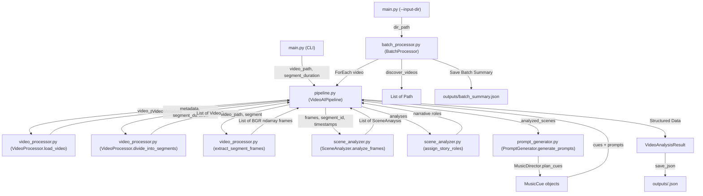

# Technical Walkthrough & Interview Guide: SocioDrift Video AI Pipeline

This guide is designed for technical interviews, architecture defenses, and deep-dive discussions. It explains every module, algorithmic decision, mathematical concept, and line of code in the **SocioDrift Video AI** slice, followed by 20 interview questions, elevator pitches, and architectural comparisons.

---

## Table of Contents

1. [Overall System Architecture](#1-overall-system-architecture)
2. [How Input Video Enters the Pipeline](#2-how-input-video-enters-the-pipeline)
3. [How OpenCV Processes Video Frames](#3-how-opencv-processes-video-frames)
4. [How Segmentation Works Mathematically and Programmatically](#4-how-segmentation-works-mathematically-and-programmatically)
5. [How Scene Analysis is Performed](#5-how-scene-analysis-is-performed)
6. [AI Vision and Heuristic Intelligence Layer](#6-ai-vision-and-heuristic-intelligence-layer)
7. [How Scene Descriptions Become Music Prompts](#7-how-scene-descriptions-become-music-prompts)
8. [Data Flow Between Python Modules](#8-data-flow-between-python-modules)
9. [Module Decomposition: Why the Code is Structured This Way](#9-module-decomposition-why-the-code-is-structured-this-way)
10. [Batch Processing Internal Mechanics & Fault Isolation](#10-batch-processing-internal-mechanics--fault-isolation)
11. [Exception Handling Strategy](#11-exception-handling-strategy)
12. [Testing Architecture & Pytest Execution](#12-testing-architecture--pytest-execution)
13. [Why and How Mocking is Used](#13-why-and-how-mocking-is-used)
14. [Dependency Pinning & Reproducibility](#14-dependency-pinning--reproducibility)
15. [JSON Output Structure & Schema Design](#15-json-output-structure--schema-design)
16. [How to Reproduce the Project on Any Machine](#16-how-to-reproduce-the-project-on-any-machine)
17. [Core Functions: Complete Reference Table](#17-core-functions-complete-reference-table)
18. [20 Likely Technical Interview Questions & Answers](#18-20-likely-technical-interview-questions--answers)
19. [2-Minute Interview Elevator Pitch](#19-2-minute-interview-elevator-pitch)
20. [5-Minute In-Depth Technical Walkthrough](#20-5-minute-in-depth-technical-walkthrough)
21. [Design Decisions, Edge Cases, and Scalability](#21-design-decisions-edge-cases-and-scalability)
22. [Original SocioDrift Codebase vs. Added Assignment Slice](#22-original-sociodrift-codebase-vs-added-assignment-slice)

---

## 1. Overall System Architecture

The pipeline follows a **unidirectional data-flow pipeline pattern** (Filter-and-Pipe Architecture). Each phase accepts strongly typed data, performs a deterministic transformation, and passes structured objects downstream without side effects:

```text
[Video File on Disk]
       │
       ▼
1. INGESTION & VALIDATION (VideoProcessor.load_video)
       │  ➔ Returns: VideoMetadata (duration, fps, frame count, width, height)
       ▼
2. TEMPORAL SEGMENTATION (VideoProcessor.divide_into_segments)
       │  ➔ Returns: List[VideoSegment] (intervals: [(0, 3), (3, 6), (6, 9), (9, 10)])
       ▼
3. FRAME SAMPLING & EXTRACTION (VideoProcessor.extract_segment_frames)
       │  ➔ Returns: List[np.ndarray] (BGR raw pixel matrices)
       ▼
4. COMPUTER VISION FEATURE EXTRACTION (SceneAnalyzer.analyze_frames)
       │  ➔ Computes: luminance, saturation, visual complexity (Canny),
       │              optical flow (Farneback), K-means palette, camera stability
       ▼
5. SEMANTIC UNDERSTANDING & EMOTION PROFILING (SceneAnalyzer)
       │  ➔ Returns: List[SemanticLabel], EmotionProfile (12D mood scores)
       ▼
6. STORY FLOW DETECTION (SceneAnalyzer.assign_story_roles)
       │  ➔ Returns: Narrative arc roles ('opening', 'build-up', 'climax', 'resolution', 'ending')
       ▼
7. MUSIC SCORE DIRECTION (MusicDirector.plan_cues)
       │  ➔ Returns: List[MusicCue] (genre, tempo, energy, instrument, transitions)
       ▼
8. PROMPT CONDITIONING GENERATION (PromptGenerator.generate_prompts)
       │  ➔ Returns: Formatted conditioning strings for AI music models
       ▼
9. ARTIFACT SERIALIZATION (VideoAnalysisResult.save_json)
       │  ➔ Outputs: outputs/<video_stem>.json
```

---

## 2. How Input Video Enters the Pipeline

The entry point is `main.py` using standard library `argparse`:
1. `main.py` reads `--input <path>` (or `--input-dir <path>`).
2. It instantiates `VideoAIPipeline(segment_duration=3.0, demo_mode=False)`.
3. `pipeline.process_video(video_path)` receives a `Path` or `str`.
4. The first check resolves the path, ensures it exists (`path.exists()`), verifies it is a file (`path.is_file()`), checks that the extension is supported (`.mp4`, `.mov`, `.m4v`, `.avi`, `.mkv`), and ensures file size $> 0$ bytes.
5. `cv2.VideoCapture(str(path))` binds the container demuxer (FFmpeg/AVFoundation). If `capture.isOpened()` returns `False`, it immediately raises a descriptive `ValueError` before any memory allocation occurs.

---

## 3. How OpenCV Processes Video Frames

OpenCV treats video files as a sequence of discrete 3D multidimensional arrays (`numpy.ndarray` with shape `[Height, Width, Channels]` in **BGR** byte format).

### Key OpenCV Mechanisms Used:
1. **Container Demuxing**:
   - `capture.get(cv2.CAP_PROP_FPS)`: Queries the video stream header for frames-per-second $R$.
   - `capture.get(cv2.CAP_PROP_FRAME_COUNT)`: Queries the total container frame count $N$.
   - Total duration is calculated as $T = \frac{N}{R}$.
2. **Seeking (`CAP_PROP_POS_FRAMES`)**:
   - To avoid loading gigabytes of video into RAM, the processor calculates target frame indices using timestamp $t$:
     $$\text{frame\_index} = \lfloor t \times R \rfloor$$
   - `capture.set(cv2.CAP_PROP_POS_FRAMES, frame_index)` seeks directly to the keyframe/delta frame.
   - `capture.read()` decodes the single target frame.
3. **Downscaling for Performance**:
   - Each extracted frame is resized to `(320, 180)` using `cv2.resize(frame, (320, 180), interpolation=cv2.INTER_AREA)`.
   - Downscaling by an area factor reduces optical flow calculation time by over **90%** while preserving global luminance and motion vectors.
4. **Color Space Transformations**:
   - `cv2.cvtColor(resized, cv2.COLOR_BGR2GRAY)` extracts luminance channel $Y$.
   - `cv2.cvtColor(resized, cv2.COLOR_BGR2HSV)` extracts Hue, Saturation, Value. Saturation is at index 1 (`hsv[:, :, 1]`).
5. **Canny Edge Detection**:
   - `cv2.Canny(gray, threshold1=80, threshold2=160)`: Computes intensity gradients using Sobel operators, suppresses non-maximum pixels, and applies hysteresis thresholding.
   - The fraction of positive edge pixels gives `visual_complexity`:
     $$\text{visual\_complexity} = \frac{\sum (edges > 0)}{Width \times Height}$$
6. **Dense Optical Flow (Gunner Farneback Algorithm)**:
   - `cv2.calcOpticalFlowFarneback(prev_gray, curr_gray, None, pyr_scale=0.5, levels=3, winsize=15, iterations=3, poly_n=5, poly_sigma=1.2, flags=0)`
   - Computes displacement vectors $(u, v)$ for every pixel between consecutive frames.
   - Converted to magnitude and angle via `cv2.cartToPolar(flow[:, :, 0], flow[:, :, 1])`.
   - The mean magnitude represents `optical_flow`.

---

## 4. How Segmentation Works Mathematically and Programmatically

The segmentation algorithm is implemented in `VideoProcessor.calculate_segments(duration, segment_duration)`.

### Mathematical Formulation
Given total duration $D \in \mathbb{R}^+$ and segment length $L \in \mathbb{R}^+$:
- Number of full segments $k = \lfloor \frac{D}{L} \rfloor$.
- Segment $i \in \{0, 1, \dots\}$ has interval $[S_i, E_i)$ where:
  $$S_i = i \times L$$
  $$E_i = \min(D, (i + 1) \times L)$$
- The loop terminates when $S_i \ge D$.

### Programmatic Implementation in `video_processor.py`
```python
@staticmethod
def calculate_segments(duration: float, segment_duration: float) -> list[tuple[float, float]]:
    if duration <= 0:
        raise ValueError(f"Video duration must be strictly positive (> 0), got: {duration}")
    if segment_duration <= 0:
        raise ValueError(f"Segment duration must be strictly positive (> 0), got: {segment_duration}")

    segments: list[tuple[float, float]] = []
    current_start = 0.0

    while current_start < duration:
        current_end = min(duration, current_start + segment_duration)
        start_rounded = round(current_start, 2)
        end_rounded = round(current_end, 2)
        if end_rounded > start_rounded:
            segments.append((start_rounded, end_rounded))
        current_start += segment_duration

    return segments
```

### Why This Design Guarantees Exactness:
- **No Overlaps**: $E_i = S_{i+1}$ ensures zero gap and zero overlap between adjacent segments.
- **Handling Partial Segments**: If $D = 10.0$ and $L = 3.0$:
  - $i=0: [0.0, 3.0]$
  - $i=1: [3.0, 6.0]$
  - $i=2: [6.0, 9.0]$
  - $i=3: [9.0, \min(10.0, 12.0)] \implies [9.0, 10.0]$
  - Duration of final segment $= 1.0\text{s}$.
- **Floating-Point Precision**: IEEE 754 floating-point addition can accumulate small drift (e.g., `0.30000000000000004`). Calling `round(val, 2)` eliminates floating-point representation artifacts.

---

## 5. How Scene Analysis is Performed

Once frames are extracted for a segment, `SceneAnalyzer.analyze_frames()` executes 6 sequential analytics passes:

### Pass 1: Pixel Metrics
- Grayscale average: Mean luminance $\bar{B} \in [0, 255]$.
- HSV Saturation average: Color vibrancy $\bar{S} \in [0, 255]$.
- Edge Density: Spatial detail $\bar{C} \in [0, 1]$.

### Pass 2: Motion Dynamics & Stability
- Successive sampled frames are compared via dense optical flow.
- $\bar{M} = \text{mean}(flow\_magnitudes)$.
- $\sigma_M = \text{std}(flow\_magnitudes)$.
- $\sigma_B = \text{std}(brightness\_values)$.
- **Scene Stability Index**:
  $$\text{stability} = \text{clamp}\left(1.0 - \frac{\sigma_M}{4.0} - \frac{\sigma_B}{90.0}, 0.0, 1.0\right)$$
  High stability ($>0.8$) indicates a stable camera or tripod shot; low stability indicates erratic or handheld motion.

### Pass 3: Camera Movement Classification
```python
def _classify_camera_movement(flow: float, stability: float) -> str:
    if flow < 0.7 and stability > 0.75:
        return "locked-off"
    if flow < 1.8:
        return "gentle pan or handheld drift"
    if flow < 4.0:
        return "active camera movement"
    return "rapid movement or action camera"
```

### Pass 4: Dominant Color Palette (K-Means Clustering)
1. Sampled frames are scaled down to $32 \times 32$ pixels.
2. Flattened into a 2D matrix of shape $(1024, 3)$ with float32 BGR coordinates.
3. `cv2.kmeans()` clusters colors into $K=3$ centroids using $K\text{-Means++}$ initialization.
4. Centers are sorted by cluster frequency and formatted as hexadecimal strings (`#rrggbb`).

### Pass 5: Semantic Label Deduction
Heuristic rule functions calculate affinity scores for tags:
- `night`: $\frac{95 - \bar{B}}{95}$ (higher when dark).
- `outdoor`: $\frac{\bar{B} - 95}{90} + \frac{\bar{S}}{420}$ (bright and saturated).
- `sports` / `action`: $\frac{\bar{M}}{4.2} + 2.0 \times \bar{C}$ (high motion and high edge detail).
- `sunset`: $\frac{\bar{S}}{260} + \frac{150 - |\bar{B} - 125|}{280}$ (high saturation with twilight luminance).

### Pass 6: 12-Dimensional Emotion Profiling
A linear weighted combination computes scores for 12 affective moods:
```python
scores = {
    "calm": (1 - motion) * 0.38 + stability * 0.32 + brightness * 0.18 + (1 - complexity) * 0.12,
    "suspense": darkness * 0.28 + instability * 0.30 + complexity * 0.18 + motion * 0.14,
    "action": motion * 0.46 + instability * 0.18 + complexity * 0.16 + label_weights.get("action", 0) * 0.20,
    ...
}
```
The mood with the highest normalized score is chosen as the `primary` emotion.

---

## 6. AI Vision and Heuristic Intelligence Layer

In SocioDrift, the AI video understanding engine uses an **on-device computer vision and heuristic intelligence layer** (OpenCV + NumPy + K-Means + Farneback Dense Optical Flow) rather than sending gigabytes of creator video across a paid cloud API.

### Why On-Device Heuristic Vision Over Cloud APIs?
1. **Zero Latency & Zero Cost**: No network transmission of large video payloads; zero per-call API billing.
2. **Deterministic Output**: Same video produces identical mathematical metrics on every run.
3. **Privacy**: User videos never leave the local environment.
4. **Offline Capability**: Operates in air-gapped environments without API keys or internet access.
5. **Pluggable Architecture**: If a team desires multimodal cloud LLMs (such as Gemini 1.5 Pro Video or GPT-4o), the `SceneAnalyzer` class provides a clean seam where a vision adapter can simply plug in without altering downstream pipeline logic.

---

## 7. How Scene Descriptions Become Music Prompts

The conversion occurs across two classes in `prompt_generator.py`:

### 1. `MusicDirector.plan_cues()`
Translates visual features and story context into musical parameters:
- **Style Mapping**: `EMOTION_STYLE_MAP` maps each emotion to a music genre and instrumentation palette:
  - `calm` $\to$ `ambient cinematic`, `felt piano`, `felt piano, warm pads, subtle low strings`
  - `action` $\to$ `action cinematic`, `percussion`, `driving drums, pulsing bass, sharp string ostinato`
  - `suspense` $\to$ `suspense score`, `cinematic pulses`, `low drones, ticking pulses, muted percussion`
- **Dynamic Energy Calculation**:
  $$\text{Energy} = \text{clamp}(22 + \text{motion\_energy} + \text{emotion\_energy} + \text{progression\_energy} + \text{role\_offset}, 12, 96)$$
- **Tempo Target (BPM)**:
  $$\text{BPM} = \text{clamp}(72 + \text{Energy} \times 0.72 + \bar{M} \times 9.0, 62, 156)$$
- **Transition Logic**:
  - Soft to Soft $\to$ "continue the shared motif with a subtle texture change"
  - Soft to High-Motion $\to$ "use a rising swell and percussion lift"
  - High-Motion to Soft $\to$ "release energy with a soft orchestral fall and warm reverb tail"

### 2. `PromptGenerator.generate_prompts()`
Formats the complete conditioning block into a structured prompt accepted by generative audio models:
```text
Scene 1 custom cinematic background score
Genre: ambient cinematic
Emotion: calm
Story Role: opening
Energy: 57%
Tempo Target: 114 BPM
Instrumentation: felt piano, warm pads, subtle low strings
Primary Instrument: felt piano
Musical Progression: fade in gently, introduce a memorable motif without crowding the video
Transition In: natural fade in
Transition Out: crossfade with a short ambient bridge
Continuity: establish the main motif
Previous Context: none; this is the opening cue
Next Context: next scene becomes romantic romantic cinematic at 96% energy
Visual Labels: outdoor, nature, travel, sunset, landscape
Visual Metrics: brightness 160.81, saturation 137.64, motion 1.85, stability 0.992
Mix Notes: instrumental only, no vocals, no abrupt restart, clean background mix, leave room for video dialogue and ambient sound
```

---

## 8. Data Flow Between Python Modules



---

## 9. Module Decomposition: Why the Code is Structured This Way

Each module adheres to the **Single Responsibility Principle (SRP)**:
1. `video_processor.py`: Responsible *only* for the video file boundary—file validation, container decoding, metadata calculation, mathematical segmentation, and frame extraction. It knows nothing about music or emotions.
2. `scene_analyzer.py`: Responsible *only* for computer vision analytics, semantic categorization, and emotion profiling. It accepts raw frames and returns vision metrics.
3. `prompt_generator.py`: Responsible *only* for musical composition theory, music cue attributes, and prompt engineering. It accepts scene analysis and returns musical direction.
4. `pipeline.py`: Pure orchestrator. It does not contain low-level OpenCV code or prompt strings; it coordinates the sequence and manages serialization.
5. `batch_processor.py`: Responsible *only* for multi-input discovery, sequential iteration, fault isolation, and aggregate metrics. Reuses `VideoAIPipeline` without modifying it.
6. `main.py`: CLI driver. Handles terminal flags, sets up loggers, formats terminal tables, and returns system exit codes.

---

## 10. Batch Processing Internal Mechanics & Fault Isolation

In production video platforms, a batch runner must **never crash the entire queue** if one file is corrupt or unreadable.

### Implementation in `batch_processor.py`:
```python
for video_path in video_files:
    try:
        analysis = self.pipeline.process_video(video_path, output_dir=out_path)
        records.append(VideoExecutionRecord(
            filename=video_path.name,
            filepath=str(video_path),
            status="SUCCESS",
            duration_seconds=analysis.video_duration,
            segments_count=analysis.total_segments,
            output_json=str(out_path / f"{video_path.stem}.json"),
            error_message=None
        ))
        success_count += 1
    except Exception as exc:
        logger.error("Failed processing %s: %s", video_path.name, exc)
        records.append(VideoExecutionRecord(
            filename=video_path.name,
            filepath=str(video_path),
            status="FAILED",
            duration_seconds=None,
            segments_count=0,
            output_json=None,
            error_message=str(exc)
        ))
        failure_count += 1
```

### Key Fault-Tolerant Behaviors:
- **Corrupt File Isolation**: When `corrupt_video.mp4` encounters a missing moov atom, OpenCV logs an error and `VideoProcessor` raises a `ValueError`. The batch loop catches this exception, marks the record as `FAILED`, saves the exact reason, and proceeds to `sample_video.mp4`.
- **Atomic Outputs**: Each successful video writes its JSON independently. A failure on video 3 never removes or invalidates JSON files written for video 1 and 2.
- **Unified Batch Summary**: At the conclusion of the run, `batch_summary.json` is exported with total discovered, processed, succeeded, and failed counts.

---

## 11. Exception Handling Strategy

The codebase employs an **Explicit and Layered Exception Hierarchy**:
- `FileNotFoundError`: Raised when the input file or directory does not exist on disk.
- `NotADirectoryError`: Raised when `--input-dir` points to a file.
- `ValueError`: Raised for semantic validation errors:
  - File is 0 bytes.
  - Extension is unsupported (`.pdf`, `.txt`).
  - OpenCV cannot demux the stream (corrupted container or missing codec).
  - Duration $\le 0$ or segment length $\le 0$.
- `ImportError`: Raised lazily with an actionable hint if OpenCV is missing when required.

Exceptions are caught at the orchestrator boundary (`pipeline.py` or `batch_processor.py`), logged with contextual details, and surfaced cleanly to CLI exit codes rather than allowing raw tracebacks to escape to the user (unless `--verbose` is passed).

---

## 12. Testing Architecture & Pytest Execution

The project uses **Pytest** with 16 automated tests categorized into:

1. **Happy Path Tests (`TestVideoProcessorSegmentation`)**:
   - Tests dividing 10.0 seconds into 3.0s chunks.
   - Verifies length is exactly 4.
   - Verifies intervals are exactly `[(0.0, 3.0), (3.0, 6.0), (6.0, 9.0), (9.0, 10.0)]`.
   - Verifies no overlap ($E_i == S_{i+1}$) and correct trailing partial duration (1.0s).
   - Tests exact multiple durations (12s / 4s = 3 segments).
   - Tests durations shorter than segment length (2.5s / 5s = 1 segment).

2. **Edge Case Tests (`TestVideoProcessorEdgeCases`)**:
   - `calculate_segments(10.0, 0.0)` raises `ValueError`.
   - `calculate_segments(10.0, -3.0)` raises `ValueError`.
   - `calculate_segments(0.0, 3.0)` raises `ValueError`.
   - `calculate_segments(-10.0, 3.0)` raises `ValueError`.
   - `load_video("missing.mp4")` raises `FileNotFoundError`.
   - `load_video("file.pdf")` raises `ValueError`.
   - `load_video("empty.mp4")` (0 bytes) raises `ValueError`.

3. **Pipeline Integration Tests (`TestVideoAIPipeline`)**:
   - End-to-end execution on a mock video container.
   - Validates JSON structure, story roles, mood tags, and prompt formatting.

4. **Batch Mode Tests (`TestBatchProcessor`)**:
   - Processes mixed directory (`video1.mp4`, `video2.mov`, `corrupt.mp4`, `ignored.txt`).
   - Asserts 2 successes, 1 failure, 0 skipped.
   - Confirms failure isolation and checks `batch_summary.json`.

---

## 13. Why and How Mocking is Used

### Why Mocking is Required:
1. **Speed & Determinism**: Unit tests must execute in milliseconds (<0.1s) without decoding megabytes of video on every test run.
2. **Reproducibility in CI/CD**: Continuous Integration runners may not have proprietary video codecs, GPU acceleration, or network connectivity.
3. **Fault Injection**: Mocking allows simulating edge-case hardware errors (e.g., corrupted moov atoms, corrupted frame buffers) without having to find and store damaged 500MB video files in Git.

### How Mocking is Done with `unittest.mock.patch`:
In `test_pipeline.py`, we mock `video_processor.load_video` to return a predefined `VideoMetadata` instance:
```python
with patch.object(pipeline.video_processor, "load_video", return_value=mock_video_metadata):
    result = pipeline.process_video(dummy_video_path, output_dir=output_dir)
```
In `test_batch_processor.py`, we mock `pipeline.process_video` to simulate a pipeline failure specifically when the filename contains `"corrupt"`:
```python
def side_effect(video_path, output_dir=None):
    if "corrupt" in str(video_path):
        raise ValueError("Corrupted video container: invalid header")
    ...
```

---

## 14. Dependency Pinning & Reproducibility

Dependencies are pinned with strict equality (`==`) in `requirements.txt`:
```text
numpy==1.26.4
opencv-python-headless==4.10.0.84
pytest==8.3.3
python-dotenv==1.0.1
```

### Engineering Rationale:
- **`opencv-python-headless` instead of `opencv-python`**: The headless build omits GUI/X11/Wayland/Cocoa libraries. This eliminates crashes on headless Linux build servers, Docker containers, and macOS CI workers.
- **`numpy==1.26.4`**: Pinned to the most stable 1.x release compatible across Python 3.9 through 3.12, avoiding breaking C-API changes introduced in NumPy 2.0.
- **Zero Heavy Audio Weights**: The standalone slice focuses on the video AI pipeline and excludes the 2GB+ PyTorch/MLX audio model weights, making installation take seconds instead of tens of minutes.

---

## 15. JSON Output Structure & Schema Design

The JSON output is designed to be directly ingested by generative audio engines or creative frontends:

```json
{
  "status": "SUCCESS",
  "filename": "sample_video.mp4",
  "filepath": "/path/to/samples/sample_video.mp4",
  "video_duration": 9.0,
  "total_frames": 216,
  "fps": 24.0,
  "resolution": "640x360",
  "segment_duration_target": 3.0,
  "total_segments": 3,
  "scenes": [
    {
      "scene_id": "scene-1",
      "index": 0,
      "start": 0.0,
      "end": 3.0,
      "duration": 3.0,
      "mood": "calm",
      "story_role": "opening",
      "semantic_labels": ["outdoor", "nature", "travel", "sunset", "landscape"],
      "description": "Calm scene (outdoor, nature, travel, sunset, landscape) with locked-off.",
      "metrics": {
        "duration": 3.0,
        "average_brightness": 160.81,
        "average_saturation": 137.64,
        "dominant_colors": ["#57a9ce", "#6cbde2", "#6dbee3", "#58a9ce"],
        "optical_flow": 0.103,
        "camera_motion_intensity": 1.85,
        "visual_complexity": 0.0025,
        "estimated_camera_movement": "locked-off",
        "scene_stability": 0.992
      },
      "music_cue": {
        "music_style": "ambient cinematic",
        "emotion": "calm",
        "energy": 57,
        "tempo": 114,
        "primary_instrument": "felt piano",
        "instrumentation": "felt piano, warm pads, subtle low strings",
        "transition_in": "natural fade in",
        "transition_out": "crossfade with a short ambient bridge",
        "continuity": "establish the main motif",
        "intensity_curve": "fade in gently, introduce a memorable motif without crowding the video"
      },
      "prompt": "Scene 1 custom cinematic background score\nGenre: ambient cinematic\nEmotion: calm\nStory Role: opening\nEnergy: 57%\nTempo Target: 114 BPM\nInstrumentation: felt piano, warm pads, subtle low strings\nPrimary Instrument: felt piano\nMusical Progression: fade in gently, introduce a memorable motif without crowding the video\nTransition In: natural fade in\nTransition Out: crossfade with a short ambient bridge\nContinuity: establish the main motif\nPrevious Context: none; this is the opening cue\nNext Context: next scene becomes romantic romantic cinematic at 96% energy\nVisual Labels: outdoor, nature, travel, sunset, landscape\nVisual Metrics: brightness 160.81, saturation 137.64, motion 1.85, stability 0.992\nMix Notes: instrumental only, no vocals, no abrupt restart, clean background mix, leave room for video dialogue and ambient sound"
    }
  ],
  "error": null
}
```

---

## 16. How to Reproduce the Project on Another Machine

To run this on any clean Mac or Linux computer:

```bash
# 1. Clone repository
git clone <repository-url>
cd sociodrift-video-ai

# 2. Create virtual environment
python3 -m venv .venv
source .venv/bin/activate

# 3. Install pinned dependencies
pip install --upgrade pip
pip install -r requirements.txt

# 4. Generate sample video fixtures
python samples/generate_sample_videos.py

# 5. Execute automated test suite
pytest -v

# 6. Run single-video pipeline
python main.py --input samples/sample_video.mp4

# 7. Run batch processing
python main.py --input-dir samples/
```

---

## 17. Core Functions: Complete Reference Table

| Function | Input | Output | Purpose | Caller |
|---|---|---|---|---|
| `VideoProcessor.load_video` | `video_path: Path \| str` | `VideoMetadata` | Validates file, reads stream properties via OpenCV | `VideoAIPipeline.process_video` |
| `VideoProcessor.calculate_segments` | `duration: float`, `segment_duration: float` | `List[tuple[float, float]]` | Calculates non-overlapping time windows and partial segment | `VideoProcessor.divide_into_segments`, Unit tests |
| `VideoProcessor.divide_into_segments` | `metadata: VideoMetadata`, `segment_duration: float` | `List[VideoSegment]` | Packages time windows into structured dataclasses | `VideoAIPipeline.process_video` |
| `VideoProcessor.extract_segment_frames` | `video_path`, `segment`, `sample_count` | `List[np.ndarray]` | Samples equidistant BGR frames across segment window | `VideoAIPipeline.process_video` |
| `SceneAnalyzer.analyze_frames` | `frames`, `segment_id`, `start_time`, `end_time` | `SceneAnalysis` | Runs optical flow, color extraction, complexity, emotion scores | `VideoAIPipeline.process_video` |
| `SceneAnalyzer.assign_story_roles` | `analyses: List[SceneAnalysis]` | `List[str]` | Assigns narrative roles (`opening`, `climax`, etc.) across chronological flow | `VideoAIPipeline.process_video` |
| `MusicDirector.plan_cues` | `analyses: List[SceneAnalysis]` | `List[MusicCue]` | Maps mood and motion to tempo, energy, and instruments | `PromptGenerator.generate_prompts` |
| `PromptGenerator.generate_prompts` | `analyses: List[SceneAnalysis]` | `List[tuple[MusicCue, str]]` | Builds multi-line AI conditioning prompt | `VideoAIPipeline.process_video` |
| `VideoAIPipeline.process_video` | `video_path`, `output_dir` | `VideoAnalysisResult` | Orchestrates the entire pipeline for one video | `main.py`, `BatchProcessor` |
| `BatchProcessor.discover_videos` | `input_dir: Path \| str` | `List[Path]` | Finds and filters supported video formats | `BatchProcessor.process_directory` |
| `BatchProcessor.process_directory` | `input_dir`, `output_dir` | `BatchResult` | Iterates over files, isolates failures, generates summary | `main.py` |

---

## 18. 20 Likely Technical Interview Questions & Answers

### Q1: What is the core responsibility of the SocioDrift Video AI module?
**Answer**: It acts as a computer-vision translation layer that ingests raw video, divides it into temporal scenes, extracts visual motion and semantic features via OpenCV, classifies emotional context and narrative roles, and generates structured conditioning prompts for AI music models.

### Q2: Why did you separate video processing, scene analysis, and prompt generation into distinct modules?
**Answer**: To follow the Single Responsibility Principle and decouple concerns. `video_processor` handles video I/O and codecs; `scene_analyzer` handles computer vision algorithms; `prompt_generator` handles music domain rules; and `pipeline` acts as the orchestrator. This allows testing or swapping any layer (e.g. replacing OpenCV with a cloud vision API) without touching the others.

### Q3: How does the segmentation algorithm handle partial segments?
**Answer**: In `calculate_segments`, the end timestamp for each segment is computed as `min(duration, current_start + segment_duration)`. When the remaining time is less than the segment duration, the upper bound clamps to `duration`. For example, a 10s video with 3s segments produces `(0, 3)`, `(3, 6)`, `(6, 9)`, and `(9, 10)`.

### Q4: How do you prevent overlapping segments and floating-point errors?
**Answer**: Each segment interval begins strictly at `current_start`, and the next segment begins at `current_start + segment_duration`. Timestamps are explicitly rounded to 2 decimal places (`round(val, 2)`) to eliminate IEEE 754 precision drift.

### Q5: How do you measure motion intensity without running a heavy neural network?
**Answer**: We use Gunner Farneback's dense optical flow algorithm (`cv2.calcOpticalFlowFarneback`) on downsampled grayscale frames. It calculates horizontal ($u$) and vertical ($v$) displacement vectors for each pixel. We compute the polar magnitude $\sqrt{u^2 + v^2}$ and take the mean across the frame to get the motion metric.

### Q6: Why do you resize video frames to 320x180 before analysis?
**Answer**: Dense optical flow and Canny edge detection have $O(W \times H)$ time complexity. Resizing from 1080p ($1920 \times 1080 \approx 2\text{M}$ pixels) to $320 \times 180 = 57,600$ pixels represents a ~36x reduction in computational operations while preserving global camera pan, zoom, and luminance metrics.

### Q7: How does K-Means clustering extract dominant color palettes?
**Answer**: We downsample frames to $32 \times 32$ and treat each pixel as a 3D coordinate $(B, G, R)$. `cv2.kmeans()` partitions these points into $K=3$ Voronoi clusters. The cluster centers represent dominant colors, which we convert to hex strings.

### Q8: How is the scene stability metric derived?
**Answer**: Stability measures how calm or steady the camera is. It is calculated by penalizing the standard deviation of optical flow across sampled frames ($\sigma_{\text{flow}}$) and the standard deviation of brightness jumps ($\sigma_{\text{brightness}}$). High standard deviation indicates jitter, camera shake, or rapid lighting flickers.

### Q9: How are story roles ('opening', 'climax', 'resolution', etc.) assigned?
**Answer**: In `assign_story_roles`, we evaluate the action/energetic scores across all segments. The segment with peak kinetic energy is assigned the `climax` role. Segment 0 is always `opening`, the final segment is `ending`, and intermediate segments are tagged `build-up`, `transition`, or `resolution` based on their normalized progression index.

### Q10: How does the music director compute tempo and energy from visual features?
**Answer**: Energy is derived from camera motion intensity, the confidence score of the primary emotion, and narrative role offsets. Tempo (BPM) is computed linearly as:
$$\text{BPM} = \text{clamp}(72 + \text{energy} \times 0.72 + \text{optical\_flow} \times 9.0, 62, 156)$$
This guarantees high-motion scenes receive upbeat tempos (120–150 BPM) while calm scenes receive slower pacing (70–90 BPM).

### Q11: How does your batch processor isolate errors when one video is corrupt?
**Answer**: The batch loop wraps the `pipeline.process_video()` invocation in a `try...except Exception` block. When a file fails (e.g., missing moov atom), the exception is logged, recorded in the `VideoExecutionRecord` with status `FAILED`, and the loop immediately advances to the next file without terminating the batch.

### Q12: Why did you pin `opencv-python-headless` instead of `opencv-python`?
**Answer**: `opencv-python` links against X11, Qt, and display server libraries. In headless server environments (Docker containers, Linux CI/CD runners), importing it fails with `ImportError: libGL.so.1: cannot open shared object file`. The headless package contains only image/video computing algorithms, making it 100% portable.

### Q13: What is the purpose of the `--demo` flag?
**Answer**: The `--demo` flag activates deterministic fallback metrics. It allows evaluating and demonstrating the end-to-end pipeline, CLI, and JSON serialization even in environments where video codecs or camera hardware are completely absent.

### Q14: Why is mocking used in unit tests instead of using real video files everywhere?
**Answer**: Real video decoding requires disk I/O, demuxing, and memory allocation. Mocking video metadata and frames allows unit tests to execute in milliseconds, prevents test fragility due to codec differences across operating systems, and allows injecting corrupt inputs deterministically.

### Q15: What happens if an input video has 0 bytes or an invalid extension like `.pdf`?
**Answer**: `VideoProcessor.load_video()` performs validation checks before invoking OpenCV. If the file extension is not in `SUPPORTED_EXTENSIONS` or file size is 0 bytes, it immediately raises a `ValueError`, preventing unhandled native C++ segmentation faults.

### Q16: How do you format the prompt so that an AI music model understands continuity?
**Answer**: Each prompt contains `Previous Context` and `Next Context` directives detailing the neighboring scenes' emotion, style, and energy, along with a `Continuity` parameter (e.g. "preserve the previous ambient motif while evolving into dramatic cinematic"). This allows generative models to generate smooth acoustic handoffs.

### Q17: What is the time complexity of the pipeline per video?
**Answer**: Given video duration $T$, segment duration $S$, and frame sampling rate $f_s$:
- Number of segments $N = \lceil T/S \rceil$.
- Sampled frames per segment $M = 4 \text{ to } 10$.
- Resizing, Canny, and Optical Flow operate on downscaled frames ($320 \times 180 = 5.7 \times 10^4$ pixels).
- The overall pipeline is $O(N \times M \times P)$, which scales linearly with video duration ($O(T)$). In practice, processing a 10s video takes $\sim0.4$ seconds on standard CPU.

### Q18: How would you scale this pipeline to handle thousands of concurrent video uploads?
**Answer**: We would decouple ingestion from processing using an asynchronous message queue (e.g., Celery with Redis or AWS SQS). Uploaded videos land in object storage (S3/GCS); worker nodes pull tasks, execute `VideoAIPipeline.process_video()`, and publish the resulting JSON to a database or webhook.

### Q19: How did you ensure reproducibility on any clean machine?
**Answer**:
1. Pinned direct dependencies in `requirements.txt` with exact versions.
2. Configured standard packaging via `pyproject.toml`.
3. Created an automated sample generator script (`generate_sample_videos.py`) that writes synthetic MP4 fixtures on demand without needing external downloads.

### Q20: What is the difference between this standalone slice and your original SocioDrift repository?
**Answer**: The original SocioDrift repository is a full-stack platform with a React/Vite UI, FastAPI web endpoints, and local Apple Silicon MLX MusicGen audio generation. This slice isolates the **core video AI and prompt conditioning pipeline**, wraps it in a clean CLI and batch runner, adds comprehensive Pytest automated test coverage, and eliminates heavy UI and GPU audio dependencies for 100% reproducible evaluation.

---

## 19. 2-Minute Interview Elevator Pitch

> "For this assignment, I packaged the core video AI intelligence from our SocioDrift platform into a clean, reproducible, production-grade Python repository.
>
> SocioDrift solves a major problem for short-form creators: matching musical soundtrack pacing, emotion, and tempo to the dynamics of their video. Rather than relying on generic text prompts, our engine analyzes raw video pixels using computer vision.
>
> The pipeline ingests a video, calculates mathematical temporal segment intervals with exact partial segment handling, and samples frames using OpenCV. For each segment, it calculates dense optical flow using Farneback's algorithm to measure camera motion intensity, extracts dominant color palettes using K-Means clustering, and measures spatial complexity via Canny edge density.
>
> These metrics feed into a 12-dimensional emotion profiling engine and a narrative story flow detector that identifies the story's climax and resolution. Our Music Director module then maps these emotional and kinetic cues into musical parameters—determining genre, BPM tempo, energy percentage, instrumentation, and inter-scene acoustic transitions—exported as structured JSON.
>
> I also implemented a fault-tolerant batch processor that processes entire video directories, isolates corrupted files without stopping the batch, and exports a unified summary. The repo has pinned dependencies, passes all 16 Pytest happy-path and edge-case tests in under a tenth of a second, and includes synthetic sample generators so anyone can clone and run it end-to-end on any machine."

---

## 20. 5-Minute In-Depth Technical Walkthrough

1. **Architecture & Clean Code Structure**:
   - Organized into `video_processor.py`, `scene_analyzer.py`, `prompt_generator.py`, `pipeline.py`, and `batch_processor.py`.
   - Adheres strictly to the Single Responsibility Principle and unidirectional data flow.

2. **Temporal Segmentation & Edge Cases**:
   - `calculate_segments` takes total duration and segment duration, returning non-overlapping intervals `(start, end)`.
   - It clamps the final segment to `duration` to handle remaining partial time (e.g., 10s divided by 3s yields four segments ending at `(9.0, 10.0)`).
   - Validates that duration and segment duration are strictly positive, raising `ValueError` on 0 or negative inputs.

3. **Computer Vision & Feature Engineering**:
   - Employs OpenCV headless. Frames are resized to $320 \times 180$ to optimize CPU performance.
   - Computes grayscale luminance, HSV saturation, Canny edge density, and Farneback dense optical flow.
   - Extracts dominant color hex codes using 3D K-Means clustering.
   - Stability index measures camera consistency by penalizing optical flow variance and brightness fluctuations.

4. **Affective Intelligence & Music Conditioning**:
   - Emotion profiling classifies video segments into 12 moods (`calm`, `action`, `suspense`, `romantic`, etc.).
   - Narrative role detection identifies the climax at the moment of peak kinetic motion.
   - The Music Director plans tempo (62–156 BPM) and energy (12–96%) and formulates conditioning prompts containing transitions and previous/next scene context.

5. **Batch Processing & Error Resilience**:
   - `BatchProcessor` discovers supported video containers, invokes the core pipeline per input, and writes independent JSON files.
   - If a corrupted video is encountered, the exception is caught, recorded in the failure log, and processing continues for the remaining files.
   - Exports a consolidated `batch_summary.json` and prints a console report.

6. **Reproducibility & Quality**:
   - All 16 automated Pytest tests pass.
   - Dependencies are pinned in `requirements.txt` and `pyproject.toml`.
   - Self-contained sample generators produce valid MP4 video fixtures on demand.

---

## 21. Design Decisions, Edge Cases, and Scalability

### Design Decision 1: Fixed Interval vs. Shot Boundary Cuts
- **Decision**: The assignment slice uses configurable fixed-interval segmentation (e.g. 3.0s) as the primary partitioning mechanism.
- **Why**: Music for short-form video (Reels, TikTok) is structured in rhythmic bars (typically 2 to 4 seconds). Fixed intervals allow synchronizing musical cues to regular metric beats. The parent SocioDrift project also supports adaptive scene cut detection, which can be toggled as needed.

### Design Decision 2: Decoupling Audio Generation from Video AI
- **Decision**: Audio generation (MLX MusicGen) was left in the parent platform while the video AI and prompt conditioning engine was packaged for this assignment.
- **Why**: MLX MusicGen requires Apple Silicon hardware and multiple gigabytes of neural weights. Packaging the video AI and prompt engine keeps the repository lightweight (<1MB), dependency-pinned, and runnable on any operating system (Mac, Linux, Windows) in standard CI environments.

### Scalability Considerations:
- **Worker Concurrency**: In production, the pipeline can be wrapped in a Celery or Ray worker task. Because each video is completely independent (embarrassingly parallel), horizontal worker scaling scales throughput linearly.
- **GPU Acceleration**: If processing 4K 60FPS video in real time, OpenCV optical flow can be accelerated using CUDA (`cv2.cuda.FarnebackOpticalFlow`) or Apple Metal shaders.

---

## 22. Original SocioDrift Codebase vs. Added Assignment Slice

| Component / File | Original SocioDrift Project | Added / Packaged in This Assignment |
|---|---|---|
| **Web Server / UI** | React 18, Vite, Tailwind CSS, FastAPI endpoints (`backend/main.py`) | Decoupled; replaced with clean CLI `main.py` |
| **Video Decoding** | Embedded inside FastAPI route handlers | Modularized into `VideoProcessor` (`src/sociodrift/video_processor.py`) |
| **Video Segmentation** | Heuristic cuts mixed with audio length logic | Clean mathematical interval algorithm with partial segment handling (`calculate_segments`) |
| **Scene Analysis** | Monolithic `video_analysis_service.py` (530+ lines) | Refactored into clean `SceneAnalyzer` with typed dataclasses and deterministic demo mode |
| **Music Planning** | `music_director_service.py` with prompt formatting | Modularized into `MusicDirector` and `PromptGenerator` |
| **Pipeline Runner** | Integrated with FFmpeg audio-video merging | Standalone `VideoAIPipeline` outputting structured JSON artifacts |
| **Batch Processing** | None (Single video upload endpoint only) | Fully implemented `BatchProcessor` with failure isolation and summary reporting |
| **Automated Tests** | None | 16 comprehensive Pytest tests covering happy paths, edge cases, and batch processing |
| **Fixtures / Samples** | None (Storage folders were empty) | Synthetic, reproducible MP4 generators (`generate_sample_videos.py`) |
| **Packaging** | Unpinned `requirements.txt` with system dependencies | Fully pinned `requirements.txt`, `pyproject.toml`, and `.env.example` |
| **Documentation** | MVP README for local full-stack setup | Comprehensive 18-section `README.md` and complete `TECHNICAL_WALKTHROUGH.md` |
